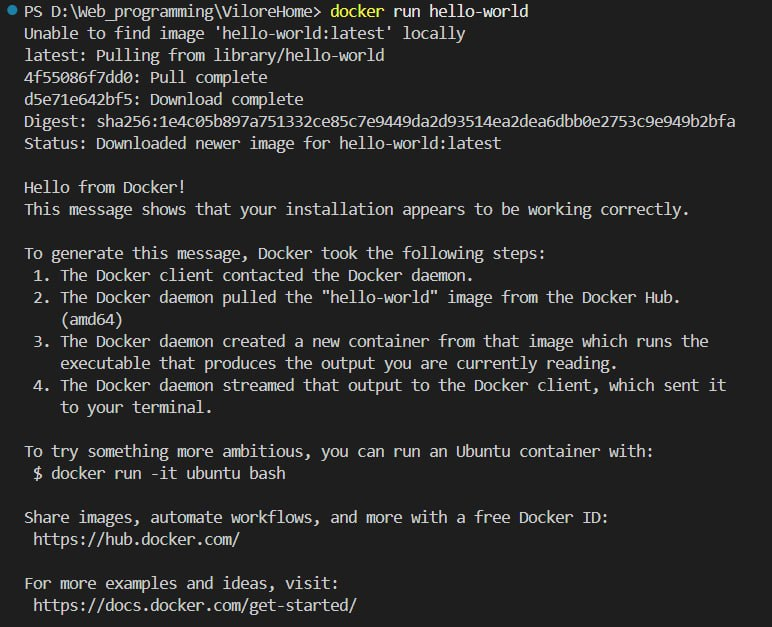
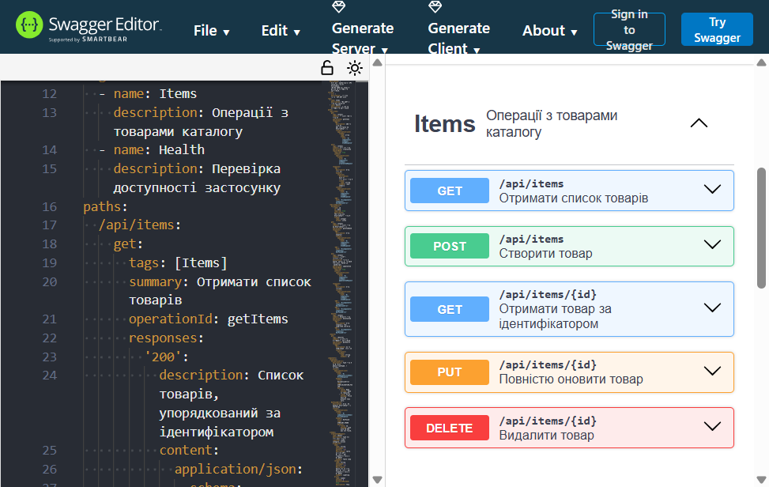
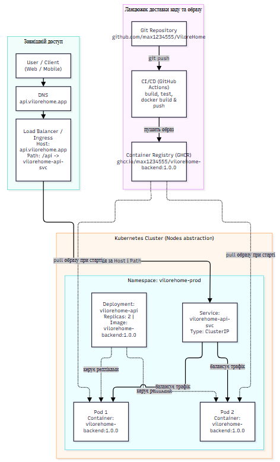

# ViloreHome

[](https://github.com/max1234555/ViloreHome/actions/workflows/ci-cd.yml)

Навчальний проєкт каталогу товарів для дому. Бекенд побудований на ASP.NET Core, EF Core та SQLite; фронтенд — на React.

## Локальний запуск

Потрібні .NET 8 SDK, Node.js і Docker Desktop.

Запуск API з кореня репозиторію:

```powershell
dotnet restore Web-prog_server/Web-prog_server.sln
dotnet run --project Web-prog_server/Web-prog_server.csproj
```

API доступний через адресу з [launchSettings.json](Web-prog_server/Properties/launchSettings.json). Перевірка працездатності:

```powershell
curl.exe -i https://localhost:7060/health
```

Запуск фронтенду в окремому терміналі:

```powershell
npm --prefix frontend ci
npm --prefix frontend run dev
```

Vite-фронтенд доступний за адресою `http://localhost:5173`.

## Запуск у Docker

Для виконання практичної №6 достатньо встановити Docker Desktop для Windows і увімкнути WSL 2.

### Передумови

- Windows 10 або Windows 11 з увімкненою віртуалізацією.
- Docker Desktop.
- Права адміністратора під час налаштування компонентів Windows.
- Увімкнені компоненти **WSL** і **Virtual Machine Platform**.

У адмін-терміналі PowerShell перевірка та налаштування WSL виконуються командами:

```powershell
wsl --install
wsl --status
dism.exe /online /enable-feature /featurename:VirtualMachinePlatform /all /norestart
```

Після увімкнення Windows-компонентів потрібно перезавантажити комп’ютер і запустити Docker Desktop.

Перевірити, що Docker працює:

```powershell
docker version
docker run --rm hello-world
```

У результаті команда `hello-world` має вивести повідомлення про успішний запуск Docker-контейнера. Цей вивід або скриншот варто зберегти як доказ для практичної.

Після встановлення перевірка має завершитися повідомленням:

```text
Hello from Docker!
This message shows that your installation appears to be working correctly.
```

Docker завантажує образ `hello-world:latest`, створює контейнер і виводить підтвердження, що клієнт Docker успішно підключився до демона.

Перевірка Docker у терміналі:



### Збірка та запуск API

З кореня репозиторію виконайте:

```powershell
docker build -t vilorehome-api:1.0.0 .
docker run --name vilorehome-api --rm -d -p 8080:8080 vilorehome-api:1.0.0
```

Перевірити доступність API:

```powershell
curl.exe -i http://localhost:8080/health
curl.exe -i http://localhost:8080/api/items
docker ps
docker logs vilorehome-api
```

Очікувана відповідь health endpoint:

```json
{"status":"ok"}
```

Зупинити контейнер:

```powershell
docker stop vilorehome-api
```

Видалити образ після демонстрації:

```powershell
docker rmi vilorehome-api:1.0.0
```

Файли [Dockerfile](Dockerfile) і [.dockerignore](.dockerignore) належать контейнеризації серверного застосунку.

## Delivery через GHCR

GitHub Actions у [.github/workflows/ci-cd.yml](.github/workflows/ci-cd.yml) автоматично restore, build і test серверного проєкту. Після успішної перевірки образ API збирається та публікується в GitHub Container Registry.

Основний образ:

```text
ghcr.io/max1234555/vilorehome-backend:latest
```

Для конкретного коміту workflow також публікує тег:

```text
ghcr.io/max1234555/vilorehome-backend:<commit-sha>
```

Запуск опублікованого образу:

```powershell
docker pull ghcr.io/max1234555/vilorehome-backend:latest
docker run --name vilorehome-api --rm -d -p 8080:8080 ghcr.io/max1234555/vilorehome-backend:latest
curl.exe -i http://localhost:8080/health
docker stop vilorehome-api
```

Якщо пакет GHCR має приватний доступ, перед `docker pull` потрібно увійти в реєстр за допомогою GitHub Personal Access Token із правом `read:packages`.

## API документація

Контракт каталогу товарів: [OpenAPI 3.0.3](docs/api/openapi.yaml). Він описує CRUD-операції для `/api/items`, перевірку доступності `/health`, DTO та формат бізнес-помилок.

Перевірка контракту у Swagger Editor:



Архітектурні рішення:

- [ADR 0001 — архітектурний стиль](docs/adr/0001-architecture-style.md)
- [ADR 0002 — шарова архітектура](docs/adr/0002-layered-architecture.md)
- [ADR 0003 — REST API та модель помилок](docs/adr/0003-api-style-and-error-model.md)


## Схема Kubernetes-додатку:

