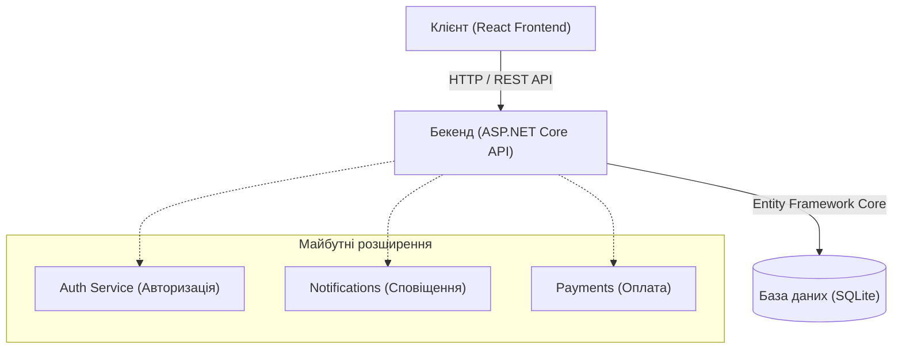

# Архітектурна діаграма проєкту ViloreHome

## Схема взаємодії компонентів

## Пояснення архітектурних блоків
1. Клієнт (React Frontend):

- Інтерфейс користувача, який працює у браузері.
- Надсилає асинхронні HTTP-запити до серверної частини та динамічно відображає отримані дані (каталог товарів, статус завантаження тощо).

2. Бекенд (ASP.NET Core API):

- Центральна серверна логіка застосунку.
- Обробляє вхідні запити, виконує бізнес-правила та взаємодіє з рівнем зберігання даних. Запускається локально через порт 5252.

3. База даних (SQLite):

- Легковажна реляційна база даних, яка забезпечує постійне зберігання сутностей проєкту (наприклад, таблиці Items) завдяки ORM Entity Framework Core.

4. Майбутні модулі (Auth, Notifications, Payments):

- Архітектурні компоненти, які закладені в план розвитку системи на найближчі тижні для додавання авторизації користувачів, системи сповіщень та обробки платежів.
