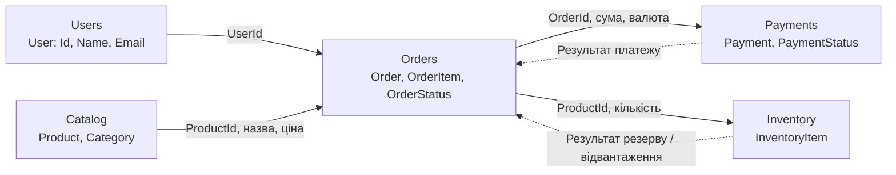

# Контекстна мапа ViloreHome

Діаграма показує логічні дані та результати, потрібні bounded contexts. Це концептуальна взаємодія: у поточному прототипі модулі не викликають один одного й не обмінюються повідомленнями.

## Пояснення зв'язків

- `Users` надає ідентифікатор користувача; `Order` зберігає його як `UserId`.
- `Catalog` містить товар і його поточну ціну. Під час додавання позиції до замовлення передаються `ProductId`, назва та ціна; `OrderItem` зберігає власну назву й ціну.
- `Orders` має статуси `Pending`, `Confirmed`, `Paid`, `Shipped`, `Completed` і `Cancelled`. Після підтвердження концептуально ініціюється оплата, а її результат відповідає переходу `MarkPaid()`.
- `Payments` має `OrderId`, суму, валюту та статус. У прототипі немає коду, який фактично створює платіж на основі замовлення чи повідомляє його результат назад.
- `Inventory` резервує та відвантажує кількість товару. Стрілки від `Orders` показують потрібний для бізнес-сценарію обмін, але автоматичної інтеграції між цими класами немає.

Наразі чинний API працює з каталогом `Item` і SQLite. Наведені контексти — доменний прототип, який ще не підключений до API, збереження даних чи зовнішніх сервісів.
