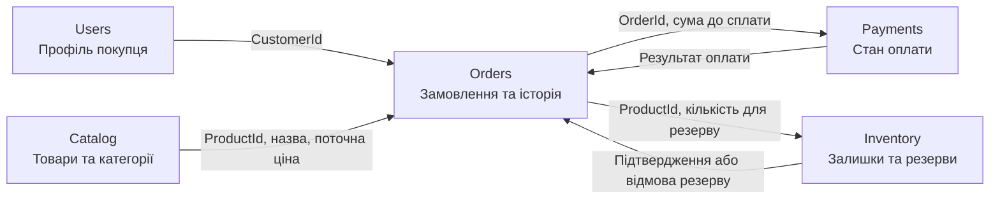

# Контекстна мапа ViloreHome

## Пояснення взаємодії

- `Catalog` є джерелом опису товару та поточної ціни. `Orders` копіює назву й ціну в `OrderItem`, щоб історія не залежала від наступних змін каталогу.
- `Orders` володіє життєвим циклом замовлення та його історією. Інші контексти посилаються на нього за `OrderId`, не змінюючи його внутрішні позиції.
- `Payments` приймає суму й `OrderId`, а повертає результат. Зміна стану платежу має спричинити команду/подію для `Orders`; у прототипі транспорт повідомлень не реалізований.
- `Inventory` самостійно перевіряє наявність і резервує кількість. `Orders` не змінює залишки напряму.
- Зв'язки на схемі описують логічні контракти модулів, а не вже наявні API чи інтеграції.

На поточному етапі реалізовано лише читання каталогу з SQLite. Решта контекстів та обмін повідомленнями — цільова архітектура навчального прототипу.
