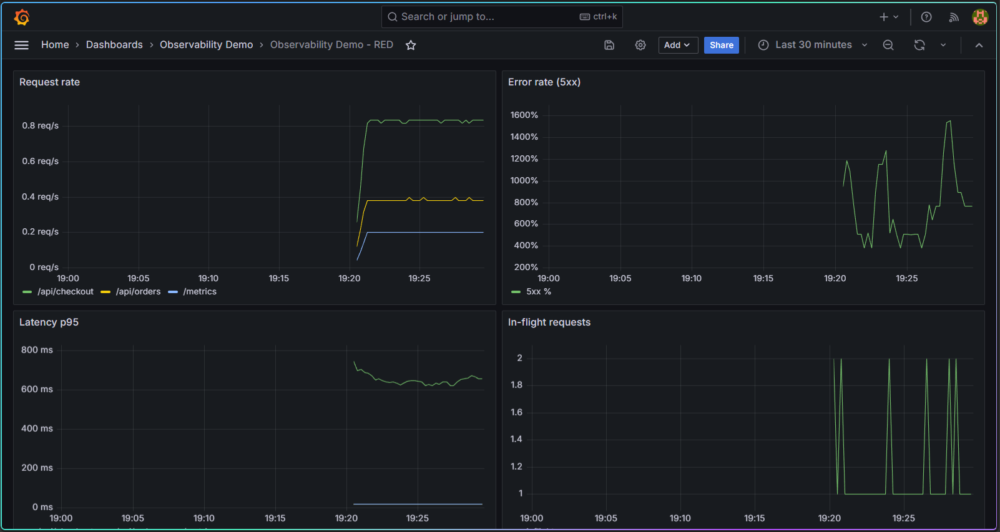
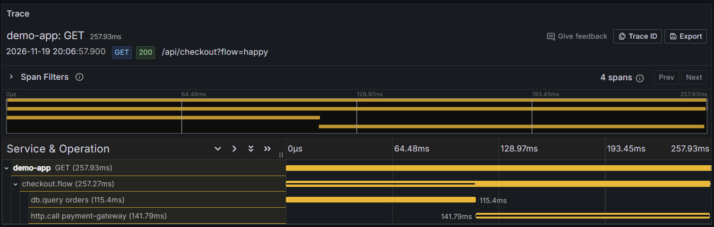
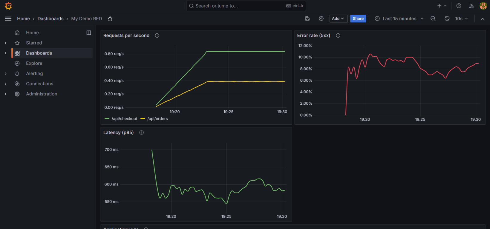
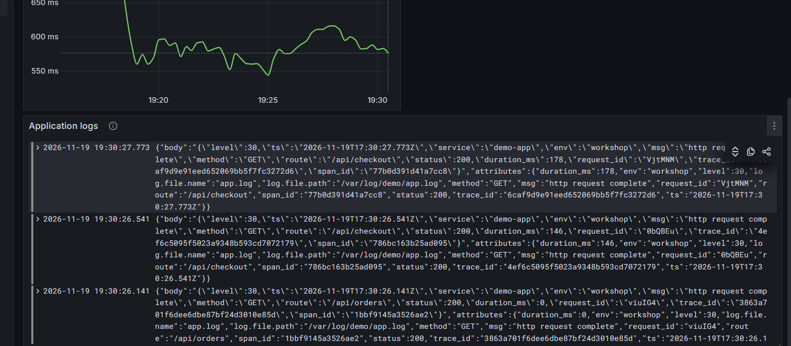

# Практична робота 8 — Observability

## Мета

Запустити навчальний стенд Grafana, Prometheus, Loki та Tempo, переглянути
метрики, логи й трейси, а також створити власний RED-дашборд на даних `demo-app`.

## Рівень 60 — запуск і базовий огляд стенду

Стенд запускається з репозиторію `observability-demo` командою:

```powershell
docker compose up -d --build
```

Для перевірки доступні 

Grafana (`http://localhost:3001`), 

API
(`http://localhost:3000`), 

Prometheus (`http://localhost:9090`), 

Loki
(`http://localhost:3100`) і

Tempo (`http://localhost:3200`). 

У Grafana відкрито
готовий дашборд **Observability Demo / RED**; у Explore перевірено трейси Tempo
та логи Loki.

### RED-дашборд



Дашборд показує частоту запитів, помилки 5xx, p95 затримку та кількість запитів
у процесі. У цьому знімку error rate перевищує 100%, тому цей показник є
аномальним і його не слід трактувати як коректну частку помилок без перевірки
формули та використаних серій метрик.

### Trace у Tempo



Показано trace `GET /api/checkout?flow=happy` зі статусом `200` і загальною
тривалістю близько 258 мс. Дочірні spans деталізують роботу checkout, запит до
бази даних і виклик платіжного сервісу; так можна знайти повільну частину
обробки запиту.

### Логи в Loki


У Loki відображені структуровані записи `demo-app` з різними рівнями
серйозності та атрибутами запитів. Логи доповнюють метрики й трейси під час
розбору помилки.

## Рівень 75 — власний дашборд

Створено дашборд **My Demo RED** з чотирма панелями. Він використовує
Prometheus для метрик і Loki для логів; початковий часовий діапазон — останні
15 хвилин. У метриках цього стенду сервіс позначений лейблом
`service="demo-app"`; внутрішній маршрут `/metrics` виключений з API-панелей.

Період дашборду змінює діапазон даних у всіх панелях. Для запитів швидкості та
p95 використовується рухоме вікно обчислення `[5m]`.

### Requests per second

```promql
sum by (route) (
  rate(http_requests_total{service="demo-app", route!="/metrics"}[5m])
)
```

Показує кількість запитів за секунду, згруповану за маршрутом API.

### Error rate (5xx)

```promql
100 * (
  sum(rate(http_requests_total{
    service="demo-app", status_code=~"5..", route!="/metrics"
  }[5m])) or vector(0)
) / clamp_min(
  sum(rate(http_requests_total{
    service="demo-app", route!="/metrics"
  }[5m])), 1e-9
)
```

Показує відсоток запитів із серверними помилками 5xx від усіх запитів до API.
Якщо серій 5xx немає, чисельник повертає нуль.

### Latency (p95)

```promql
histogram_quantile(
  0.95,
  sum by (le) (
    rate(http_request_duration_ms_bucket{
      service="demo-app", route!="/metrics"
    }[5m])
  )
)
```

Показує тривалість, у мілісекундах, нижче якої завершуються 95% запитів.
Перцентиль допомагає помітити повільні відповіді, які можуть бути непомітні за
середнім значенням.

### Application logs

```logql
{service="demo-app"}
```

Показує логи сервісу в Loki. У конфігурації цього стенду label має назву
`service`, а не `service_name`.

### Скриншоти власного дашборду

На першому зображенні показані три графіки метрик; друге зображення показує
четверту панель із логами Loki.





JSON дашборду: [my-demo-red-dashboard.json](./my-demo-red-dashboard.json).
Під час роботи стенду дашборд доступний за адресою
<http://localhost:3001/d/my-demo-red/my-demo-red>.

