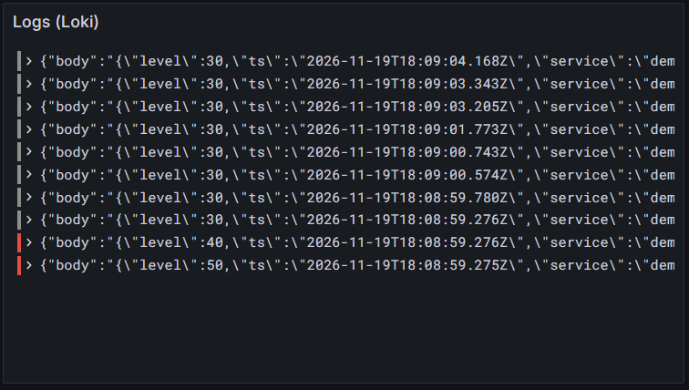

# Observability Demo

Мінімальний стенд з Node.js API, Grafana та OTEL-колектором. Ідея проста: підняв контейнери, навантаження генерує `loadgen`, у Grafana одразу є RED-дашборд. Щоб ваш сервіс з’явився на панелях, інструментація має відправляти дані з `service.name=demo-app` (app id за замовчуванням). Для швидкого старту можна скористатися [OpenTelemetry Zero-Code](https://opentelemetry.io/docs/zero-code/).

## Як запустити

```bash
cd observability-demo
docker compose up -d --build
```

Після хвилини перевірити, що сервіс доступний:

- API → http://localhost:3000
- Grafana → http://localhost:3001 (логін/пароль `admin` / `admin`)
- Prometheus → http://localhost:9090
- Loki → http://localhost:3100
- Tempo UI/API → http://localhost:3200

Після тестів можна зупинити генерувати трафік через команду `docker compose stop loadgen`.
(це для того щоб почати надсилати власний трафік)

## Куди надсилати телеметрію

- **OTLP HTTP (трейси/метрики/логи):** `http://localhost:4318`  
  приклад: `OTEL_EXPORTER_OTLP_ENDPOINT=http://localhost:4318`.
- **OTLP gRPC (напряму в Tempo):** `http://localhost:4319`.
- **Логи файлом:** додавати рядки у `./data/logs/app.log` (наприклад `echo '{"level":"info"}' >> data/logs/app.log`) або надсилати OTLP Logs на `http://localhost:4318/v1/logs` — Loki підтягне повідомлення автоматично.

Щоб дашборди ловили дані сервісу, потрібно задавати ресурсний атрибут `service.name=demo-app` (OTEL: `OTEL_RESOURCE_ATTRIBUTES=service.name=demo-app`).

Для Node.js можна скористатися `@opentelemetry/auto-instrumentations-node`:

```bash
npm install --save @opentelemetry/api @opentelemetry/auto-instrumentations-node
```

CLI варіант:

```bash
env \
  OTEL_TRACES_EXPORTER=otlp \
  OTEL_EXPORTER_OTLP_ENDPOINT=http://localhost:4318 \
  OTEL_SERVICE_NAME=demo-app \
  node --require @opentelemetry/auto-instrumentations-node/register app.js
```

Або через `export`:

```bash
export OTEL_TRACES_EXPORTER=otlp
export OTEL_EXPORTER_OTLP_ENDPOINT=http://localhost:4318
export OTEL_NODE_RESOURCE_DETECTORS=env,host,os
export OTEL_SERVICE_NAME=demo-app
export NODE_OPTIONS="--require @opentelemetry/auto-instrumentations-node/register"
node app.js
```

Запустити власний агент і відкрити в Grafana дашборд **Observability Demo / RED** — трейси та логи з’являться за хвилину.

## Як зупинити

```bash
docker compose down -v
```

Команда видалить контейнери й volume’и (окрім локальної теки `data/logs`).*** End Patch*** End Patch```}**


## Практична робота 8 — базовий огляд (60 балів)

Стенд запущено командою `docker compose up -d --build`. Для звіту додайте три знімки екрана до `docs/screenshots/` і вставте їх у відповідні місця нижче.

### RED-дашборд


На графіках видно частоту запитів до маршрутів сервісу, частку помилок 5xx, p95 затримку та кількість запитів у процесі. У цьому запуску панель Error rate показує значення понад 100%, тож її відсоток виглядає аномальним.

### Трейс у Tempo


На знімку показано trace запиту `demo-app`, його операцію, HTTP-статус і тривалість. Часова шкала дає змогу побачити тривалість span та структуру обробки запиту.

### Логи в Loki




Результати містять логи HTTP-запитів сервісу `demo-app`, зокрема час, маршрут і статус відповіді. За цими записами можна зіставити подію в логах із відповідними метриками або trace.